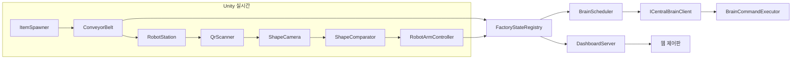

# Conveyor Belts and Robotic Arms — 중앙뇌 기반 스마트팩토리 시뮬레이션

> **ForAgents 문서 인덱스:** [Info/README.md](./README.md) (기능 ID·기술 환경·폴더 구조)

[English](./README.md) | [한국어](./README.ko.md)

여러 대의 로봇팔이 움직이는 컨베이어벨트에서 도형 물품을 집어, **QR 코드 + 카메라 기반 도형 인식**으로 검증한 뒤 구역별로 분류하는 Unity 스마트팩토리 시뮬레이션입니다. **중앙뇌**라고 부르는 하나의 LLM이 주기적으로 모든 로봇팔과 벨트의 상태를 받아 상황을 판단하고, 제어 명령을 내리며, 웹 제어판에 보고합니다. 이후 실제 로봇팔·컨베이어 하드웨어와 연동할 예정입니다.

> **진행 상태:** 개발 중입니다. Unity 시뮬레이션, 웹 제어판, 교체 가능한 인터페이스 구조는 구현되어 있습니다. 중앙뇌는 현재 **Mock 클라이언트**로 동작하며(실제 LLM API 미연동), ONNX 도형 분류기는 **스텁** 상태입니다. 최신 집기·운반 단계의 Play Mode 동작은 아직 전부 검증되지 않았습니다.

## 주요 기능

- **실시간 공장 라인** — 컨베이어벨트 운반, 물품 랜덤 생성(1~5초 간격), 여러 로봇팔 스테이션(기본 3대).
- **QR 라벨이 붙은 도형 물품** — 원(원기둥)·큐브·삼각형 물품에 도형 정보를 담은 QR 코드를 부착합니다(ZXing으로 생성).
- **물품별 인식 파이프라인**
  1. 로봇팔에 부착된 QR 스캐너로 QR 판독
  2. 로봇팔 카메라로 이미지 취득
  3. 모델 입력 전에 QR 영역 마스킹(`QrMaskBlit.shader`)
  4. 도형 분류(Teachable Machine 모델 예정, 기본값은 Mock 분류기)
  5. QR 도형과 모델 도형 비교
- **집기·운반·내려놓기** — 로봇팔이 움직이는 벨트에서 물품을 집어 들어 올린 뒤 판정 결과에 맞는 구역에 내려놓습니다.
- **중앙뇌(LLM)** — 장비 상태를 받아 제어·대응을 판단하고 상황 보고를 작성합니다. 호출 주기는 제어판에서 선택합니다.
- **웹 제어판** — 로봇팔별 상태(배터리, 작업, 진행도, 오류), 벨트 상태·속도, 중앙뇌 상태·보고, 불일치 물품 개수, API 호출 주기 설정. SSE로 실시간 갱신합니다.

## 분류 규칙 (현재 구현 기준)

| 판정 | 조건 | 배치 구역 |
| --- | --- | --- |
| `Pass` | QR 도형과 모델 도형 일치 | `NormalZone` |
| `Fail` | QR 도형과 모델 도형 불일치 | `UnprocessedZone` |
| `Error` | 인식·분류 실패 또는 신뢰도 미달 | `ErrorZone` |

정의 위치: `Assets/SmartFactory/Scripts/Items/ItemSortOutcome.cs`

## 아키텍처



중앙뇌와 도형 분류기는 인터페이스(`ICentralBrainClient`, `IShapeClassifier`) 뒤에 있으므로, 시뮬레이션 코드를 바꾸지 않고 Mock 구현을 실제 LLM 클라이언트나 ONNX 모델로 교체할 수 있습니다.

## 기술 스택

| 항목 | 버전 / 내용 |
| --- | --- |
| Unity | `6000.0.35f1` (Unity 6), URP |
| QR | ZXing (`Assets/Plugins/ZXing`) |
| 추론 | `com.unity.ai.inference` 2.2.0 (추후 ONNX 연동용) |
| 로봇 Import | `com.unity.robotics.urdf-importer` v0.5.2 |
| JSON | `com.unity.nuget.newtonsoft-json` 3.2.1 |
| 제어판 | 내장 `HttpListener` 서버 + HTML/CSS/JS (`Assets/StreamingAssets/Dashboard`) |

## 시작하기

1. Unity `6000.0.35f1`로 프로젝트를 엽니다.
2. `Assets/SmartFactory/Scenes/Factory.unity`를 엽니다.
3. 메뉴 **SmartFactory → Setup Factory Scene Orchestrator**를 실행합니다(씬에 `FactoryOrchestrator` 추가).
   - 선택: **SmartFactory → Rebuild Factory Scene (RobotArm Prefab)** 으로 로봇팔 프리팹 기반 레이아웃을 다시 구성할 수 있습니다.
4. **Play**를 누릅니다.
5. 브라우저에서 `http://localhost:8080`에 접속하면 제어판이 열립니다.

> Windows에서 제어판이 시작되지 않으면 `HttpListener`의 URL ACL 설정이나 관리자 권한이 필요할 수 있습니다.

### 테스트 씬·도구

| 메뉴 | 용도 |
| --- | --- |
| SmartFactory → Create Conveyor Test Scene | 컨베이어 / QR 스캔 구역 테스트 |
| SmartFactory → Create Robot Arm Test Scene | 단일 로봇팔 동작·집기 테스트 |
| SmartFactory → Create Robot Arm Rig Prefab | `Robotic-Arm-Rig.fbx`로 로봇팔 프리팹 생성 |
| SmartFactory → Robot Arm Rig Setup | 관절 경로 / End Effector 바인딩 수정 |
| SmartFactory → Save Masked Capture From Selected ShapeCamera | 모델 학습용 QR 마스킹 PNG 저장 |

## 설정

기본값은 `Assets/FactoryConfig.asset`(`FactoryConfig`)에 있습니다.

| 설정 | 기본값 |
| --- | --- |
| 로봇팔 수 | 3 |
| 벨트 속도 | 1.2 |
| 물품 생성 간격 | 1~5초 랜덤 |
| 불일치 주입률 | 25% |
| 중앙뇌 호출 주기 | 30분 (선택지: 10 / 20 / 30 / 40 / 50분, 1시간, 2시간) |
| 제어판 포트 | 8080 |

## 제어판 API

| 메서드 | 경로 | 설명 |
| --- | --- | --- |
| GET | `/api/state` | 현재 공장 상태 스냅샷 |
| GET / POST | `/api/settings` | 설정 조회 / 변경(중앙뇌 호출 주기 등) |
| POST | `/api/brain/trigger` | 중앙뇌 즉시 호출 |
| POST | `/api/robots/reset` | 로봇팔 초기화 |
| GET | `/api/stream` | 실시간 상태 스트림(SSE) |

## 프로젝트 구조

```text
Assets/
├─ SmartFactory/
│  ├─ Scenes/        Factory, ConveyorTest, RobotArmTest
│  ├─ Scripts/
│  │  ├─ Brain/        중앙뇌 인터페이스, Mock 클라이언트, 스케줄러, 명령 실행기
│  │  ├─ Conveyor/     벨트, QR 스캔 구역
│  │  ├─ Core/         설정, 상태 레지스트리, DTO, 도형 타입
│  │  ├─ Dashboard/    HTTP / SSE 제어판 서버
│  │  ├─ Items/        물품 생성기, QR 라벨 생성기, 분류 판정
│  │  ├─ Recognition/  QR 스캐너, 도형 카메라, 분류기, 비교기
│  │  ├─ Robot/        로봇팔 컨트롤러, 그리퍼, 구역 타깃, 배터리
│  │  └─ Editor/       SmartFactory 메뉴 도구
│  └─ Shaders/       QrMaskBlit.shader
├─ RobotArm/         Robotic-Arm-Rig.fbx, 프리팹, 리그 바인딩, 포즈 세트
├─ StreamingAssets/Dashboard/   index.html, app.js, style.css, logo.svg
└─ ThirdParty/       NiryoOne (URDF), ConveyorBelt (프리팹/모델)
Info/                ForAgents 형식 설계·구현 문서 (README.md 참조)
```

## 로드맵

- [x] 컨베이어벨트, 물품 생성, QR 라벨
- [x] QR 판독 → 카메라 취득 → QR 마스킹 → 분류 → 비교 흐름
- [x] 움직이는 벨트에서 집기·들어 올리기 (1단계)
- [x] 판정별 구역 운반·내려놓기 (2단계, Play Mode 검증 대기)
- [x] 실시간 갱신 웹 제어판
- [ ] 중앙뇌용 실제 LLM API 클라이언트
- [ ] Teachable Machine → ONNX → `OnnxShapeClassifier` 연동
- [ ] 상급자 보고 / 정비 담당 연락
- [ ] 실제 로봇팔·컨베이어 하드웨어 연동

## 문서

- [Info README (문서 인덱스)](./README.md)
- [프로젝트 개요](./메인프로젝트/전체구조/001/프로젝트_개요.md)
- [기능 분류·요구사항](./메인프로젝트/전체구조/001/기능_분류_요구사항.md)
- [구현 현황 요약](./메인프로젝트/전체구조/001/구현_현황_요약.md)
- [1단계 구현보고서 아카이브](./메인프로젝트/전체구조/001/day/2026-10-06_000000_001_스마트팩토리_1단계_구현보고서_아카이브.md)
- [로봇 Pick/Place day 아카이브](./소프트웨어/로봇집기분류/SW_Unity_RobotPickPlace_001/day/)
- [에셋 다운로드 지침](./메인프로젝트/전체구조/001/에셋_다운로드_지침.md)

## 서드파티 에셋

- [Unity Robotics Hub](https://github.com/Unity-Technologies/Unity-Robotics-Hub) — Niryo One URDF·메시 (Pick-and-Place 튜토리얼)
- [Conveyor Belt System Simulation in Unity](https://github.com/MuhammadNafishGinanjar/Conveyor-Belt-System-Simulation-in-Unity) — 컨베이어 프리팹·모델 (Asset Store의 *Low Poly Factory Machine Pack Demo* 사용)
- [ZXing.Net](https://github.com/micjahn/ZXing.Net) — QR 생성·판독

각 서드파티 에셋은 자체 라이선스를 따릅니다. 재배포나 상업적 이용 전에 원본 저장소의 조건을 확인하세요.
