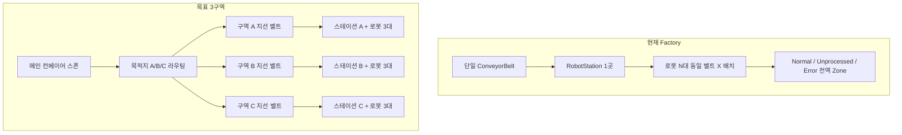
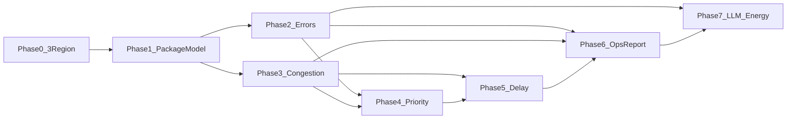

# AI 물류센터 핵심기능 — 구현 계획

- 문서 초기 생성 일시: 2026-10-20 17:30 (KST)
- 계획 상태: 진행 중
- 지시자: 이종인
- 작업자(문서): Composer
- 관련 기능 ID: 001, SW_Unity_RegionRouting_001, SW_Unity_PackageOrder_001, SW_Unity_RegionCongestion_001, SW_Unity_RecognitionError_001, SW_Unity_EquipmentGuidance_001, SW_Unity_DelayPrediction_001, SW_Unity_OpsReporting_001, SW_Unity_VirtualPlant_001
- 상세 설계: [Desktop AI_물류센터_핵심기능_상세설계서.md](file:///C:/Users/Slu93/Desktop/AI_물류센터_핵심기능_상세설계서.md)

## 근거 문서·산출물

| 항목 | 경로 |
| --- | --- |
| 상세 설계(정본) | [C:/Users/Slu93/Desktop/AI_물류센터_핵심기능_상세설계서.md](file:///C:/Users/Slu93/Desktop/AI_물류센터_핵심기능_상세설계서.md) |
| 현재 구현 요약 | [Info/메인프로젝트/전체구조/001/구현_현황_요약.md](Info/메인프로젝트/전체구조/001/구현_현황_요약.md) |
| 기능 ID(기존) | [Info/기능_ID_목록.md](Info/기능_ID_목록.md) |
| **이번에 작성할 계획** | `Info/plan/2026-10-20/{HHmmss}_AI물류센터_핵심기능_구현_plan.md` (KST, 이름 충돌 시 번호 suffix) |

사용자 확인: **범위 = 설계서 1~7단계 전체**, **물리 모델 = 메인 벨트 → A/B/C 지선 벨트 → 구역 도착 후 해당 구역에서 분류**, **구역(A/B/C)마다 스테이션 1곳 + 로봇팔 3대**(총 **9대**, 기존 단일 벨트 3대 패턴을 구역별로 복제).

---

## 현재 vs 목표 (갭)

| 설계 기능 | 현재 코드 | 갭 |
| --- | --- | --- |
| §2 택배 데이터(ID·목적지·우선순위·마감·상태) | `FactoryItem`: `ItemId`, 도형, `SortOutcome`만 | 목적지 A/B/C, 우선순위, 마감·접수 시각, 처리 단계 enum 없음 |
| §3 주문 우선순위 | `ConveyorPickDispatcher` FIFO(`m_waitQueue`) | 재정렬·변경 로그·진행 중 job 고정 없음 |
| §4 혼잡 감지 | `FactoryLineHealthMonitor` (벨트 정체·로봇 무움직임) | **구역별 대기열**·임계 3/5단계·투입률/속도 제안 없음 |
| §5 인식 오류 코드 | Pass/Fail/Error + `ErrorLogisticsKind` | `QR_READ_FAIL` 등 **오류 코드·재시도·집계** 미정형 |
| §6 장비 오류 안내 | 알림 + Mock 중앙뇌 reset | 규칙 기반 **안내 문구·단계·이력** 없음 |
| §7 지연 예측 | 없음 | 처리량·마감 기반 위험 단계 없음 |
| §8 운영 지표·보고서 | `SortingStats` 일부 | 마감 준수율·보고서 UI·세션 종료 집계 없음 |
| §9 가상 에너지/온도 | 없음 | 시뮬레이션 값 + 표기 규칙 필요 |
| §10 LLM | `MockCentralBrainClient` | 설명·요약 전용 API, **명령 실행 금지** (설계 §6.4·§12) |

핵심 코드 앵커: [FactorySceneLayout.cs](Assets/SmartFactory/Scripts/FactorySceneLayout.cs), [FactoryLayoutBuilder.cs](Assets/SmartFactory/Scripts/FactoryLayoutBuilder.cs), [ConveyorPickDispatcher.cs](Assets/SmartFactory/Scripts/Robot/ConveyorPickDispatcher.cs), [FactoryStateRegistry.cs](Assets/SmartFactory/Scripts/Core/FactoryStateRegistry.cs), [FactorySnapshot](Assets/SmartFactory/Scripts/Core/FactoryStatusDtos.cs), [DashboardServer.cs](Assets/SmartFactory/Scripts/Dashboard/DashboardServer.cs).

---

## Phase 0 — 3구역(A/B/C) 레이아웃·라우팅 (선행 필수)

**구역 정의(확정)**: 한 구역 = **지선 컨베이어 1 + RobotStation 1 + RobotArmController 3 + PickSlot 3 + 구역 전용 Pass/Fail/Error Zone**.  
현재 [FactoryConfig.robotArmCount](Assets/SmartFactory/Scripts/Core/FactoryConfig.cs)(기본 3)는 **「구역당 로봇 수」**로 재해석하고, 전역 로봇 수는 `3구역 × 3대 = 9`로 `FactoryStateRegistry.InitializeRobots`·대시보드 로봇 목록을 확장한다.

**0.1 데이터·QR**

- `DestinationRegion` enum `{ A, B, C }` 및 `PackagePriority` `{ Urgent, High, Normal }`.
- `FactoryItem` / 스폰 시 QR 페이로드에 **목적지·우선순위·마감 시각(시뮬레이션 clock)** 부여. 표시 ID는 `PKG-{ItemId:D3}` 형식.
- `ItemSpawner` + `FactoryConfig`: 목적지 분포·마감 오프셋·긴급 비율 설정(시연용).

**0.2 씬·레이아웃**

- `FactoryRegionDescriptor` (또는 `FactorySceneLayout` 확장): 구역별 `ConveyorBelt`, `RobotStation`×1, `RobotArmController`×**3**, `RobotArmPickSlot`×3(지선 X축 간격은 현재 메인 벨트 3팔 배치와 동일 패턴), `RobotArmZoneTargets`×3, 구역 내 Pass/Fail/Error Zone.
- [FactoryLayoutBuilder](Assets/SmartFactory/Scripts/FactoryLayoutBuilder.cs) / 에디터 메뉴: **메인 벨트 1 + 지선 3 + 구역당 로봇 3** 생성. `FactoryConfig`에 `regionCount=3`, `robotArmsPerRegion=3`(명칭은 기존 컨벤션에 맞게) 추가.
- **디스패처**: 구역마다 `ConveyorPickDispatcher` 1개(해당 지선 벨트 + 3 PickSlot만 바인딩). 우선순위(Phase 4)는 **구역 내부 대기열** 기준; 목적지가 다른 택배는 라우팅 후 해당 구역 디스패처만 사용.
- `FactoryLineHealthMonitor`: 로봇 배열 9대·구역별 정체 집계로 확장(또는 구역 단위 서브 모니터).
- `FactoryOrchestrator` wiring: `RobotStation`은 **구역 스테이션 1곳**이 지선 위 QR/카메라 스캔 담당(메인 벨트에는 스테이션 없음, 라우팅만).

**0.3 라우팅(메인 → 지선)**

- 메인 벨트의 **분기 트리거**(목적지별): `FactoryItem.DestinationRegion`에 따라 Rigidbody 부모 전환 + 해당 `ConveyorBelt` 등록(기존 [ConveyorBelt](Assets/SmartFactory/Scripts/Conveyor/ConveyorBelt.cs) 아이템 추적 API 확장).
- Fail/Error는 **라우팅 전 메인 스테이션** vs **구역 스테이션** 중 하나로 정책 고정(권장: 구역 도착 후 인식·판정, 라우팅은 목적지만 담당).

**0.4 완료 기준 (Phase 0)**

- Play 시 A/B/C 목적지 물류가 **각 지선 벨트로 이동**하고, **해당 구역 스테이션 + 로봇 3대**가 기존 단일 라인과 동등하게 Pick/Zone 배치(동일 구역에서 3팔 슬롯 배분·ETA 로직 재사용).
- `FactorySnapshot`: 구역별 요약 + 로봇 **9대** 개별 상태(`regionId`/`armIndexInRegion` 필드 추가 권장).
- 대시보드: 로봇 reset API는 기존처럼 **로봇 ID 단위**(9대), 구역 접기/필터 UI는 Phase 0 후반 또는 Dashboard Phase에 추가.

---

## Phase 1 — 공통 택배·상태 모델 (설계 §11-1, §2)

- `PackageLifecycleState` (대기/이동/인식/집기/완료/오류) — `FactoryItem` 또는 별도 `PackageStateTracker`에서 전이.
- `FactoryStateRegistry` / DTO 확장: `List<PackageQueueEntry>`, `List<RegionQueueStatus>`, `List<PackageErrorRecord>`.
- 대시보드 SSE JSON 스키마 버전 필드 추가(하위 호환: 기존 UI 유지 + 새 패널).

**완료 기준**: 설계 §2.1 표 항목이 스폰~완료까지 추적 가능하고 API로 조회 가능.

---

## Phase 2 — 오류 기록·예외 처리 (설계 §11-2, §5)

- `RecognitionErrorCode` 설계서 §5.2 매핑: 기존 `ItemSortOutcome`·`ErrorLogisticsKind`·QR/카메라 실패 경로와 **1:1 표** 작성 후 [RobotStation.cs](Assets/SmartFactory/Scripts/Robot/RobotStation.cs)에서 기록.
- 재시도 정책(`FactoryConfig`: maxRetries) — 재시도 중에는 정상 분류 명령 차단(설계 §5.3).
- 오류 이력 저장 + 대시보드 오류 목록·유형별 카운트.

**완료 기준**: 설계 §5.5 (불일치 즉시 정상 목적지 금지, 기록·집계).

---

## Phase 3 — 구역 대기열·혼잡 (설계 §11-3, §4)

- 구역별 `queueLength`, `oldestWaitSeconds`, 최근 처리량(10~30s 윈도우) 집계 서비스 `RegionCongestionMonitor` (신규 MonoBehaviour, [FactoryLineHealthMonitor](Assets/SmartFactory/Scripts/Core/FactoryLineHealthMonitor.cs)와 역할 분리: 전역 정체 vs **구역 혼잡**).
- 임계값: 설계 §4.3 예시(3/4/5+) → `FactoryConfig`로 조정, **시뮬레이션 값**임을 DTO·UI에 표기.
- 대응: `ItemSpawner` 투입 간격 가중·메인/지선 속도 **제안 또는 자동(시뮬만)** — 실물 속도 변경은 플래그 off 기본(설계 §4.4·§12).

**완료 기준**: §4.5 (경고·근거·해제 시각 기록). 기존 LineHealth 긴급 알림과 중복 시 severity 통합.

---

## Phase 4 — 주문 우선순위 (설계 §11-4, §3)

- `PackagePriorityScheduler`: **대기 상태**만 정렬(긴급 → 마감 임박 → 접수 시각), **목적지 구역의** `ConveyorPickDispatcher` 큐 삽입 순서에 반영(구역 간 우선순위는 동일 규칙을 구역별 큐에 독립 적용).
- **진행 중**(`IsRobotPipelineActive`, active job) 재정렬 금지(설계 §3.3-4).
- `PriorityChangeLog` → 알림 또는 전용 API `/api/packages/priority-log`.
- 대시보드: 대기 목록·색상(§3.4).

**완료 기준**: §3.6.

---

## Phase 5 — 지연 위험 예측 (설계 §11-5, §7)

- `DelayRiskEvaluator`: 구역별 `expectedWaitMin = queueCount / throughputPerMin`, 혼잡·장비 정지 시 보정 시간.
- `throughputPerMin == 0` → **「예측 불가」**(설계 §7.3).
- UI: 택배별 Normal / Caution / AtRisk + 우선순위 조정 **제안**(자동 적용은 옵션).

**완료 기준**: §7.5.

---

## Phase 6 — 운영 지표·보고서 (설계 §11-6, §8)

- 세션 집계기 `OpsMetricsCollector`: §8.2 지표(마감 준수율, 평균 대기, 시간당 처리량 등).
- Play 종료 또는 대시보드 「보고서 생성」: 수치 테이블 + **규칙 기반** 요약 문장 템플릿(§8.4 형식).
- `/api/ops/report` (JSON + HTML fragment).

**완료 기준**: §8.5 (수치는 코드 집계만, LLM 미사용 시에도 동작).

---

## Phase 7 — LLM·가상 에너지/온도 (설계 §11-7, §6.4, §9)

**7a 규칙 기반 장비 안내 (§6, 선행)**

- `EquipmentFaultCatalog`: 오류 유형 → 안내 문구·확인 순서(설계 §6.2 표).
- `FactoryStateRegistry` 알림과 연동, 반복 실패 시 재시도 중단 → 운영자 확인 상태.

**7b LLM (확장)**

- `ICentralBrainClient` 실구현 또는 Mock 확장: 입력 = **구조화 JSON(오류·로그·상태)**, 출력 = 자연어 설명만.
- `BrainCommandExecutor`: LLM 출력을 **명령으로 파싱하지 않음**(설계 §12).
- 보고서: LLM은 §8.4 문장 **다듬기**만, 숫자는 서버가 주입.

**7c 가상 에너지·온도 (§9)**

- `VirtualPlantSimulator`: 구역/벨트별 전력·온도(가상), 모드(처리량/절전/균형) — 속도·스폰과 연동.
- 대시보드 **「가상 값」** 라벨 필수(설계 §2.2 주의).

**완료 기준**: §6.5 + §9.2 + §11 표 7행.

---

## 기능 ID·Info 문서 (ForAgents)

계획 문서 **관련 ID** (기존 유지 + 신규 부여 제안 — 구현 착수 시 [기능_ID_목록.md](Info/기능_ID_목록.md) 갱신):

| 제안 ID | 중분류(한글) | 담당 Phase |
| --- | --- | --- |
| (메인) 001 | 전체구조 | 0~7 통합 아키텍처 |
| SW_Unity_RegionRouting_001 | 구역라우팅 | 0 |
| SW_Unity_PackageOrder_001 | 주문우선순위 | 1, 4 |
| SW_Unity_RegionCongestion_001 | 구역혼잡 | 3 |
| SW_Unity_RecognitionError_001 | 인식오류코드 | 2 |
| SW_Unity_EquipmentGuidance_001 | 장비오류안내 | 7a |
| SW_Unity_DelayPrediction_001 | 지연예측 | 5 |
| SW_Unity_OpsReporting_001 | 운영보고서 | 6 |
| SW_Unity_VirtualPlant_001 | 가상에너지온도 | 7c |
| 기존 SW_Unity_Dashboard_001 / FactoryState_001 / CentralBrain_001 | — | 스냅샷·UI·LLM |

각 ID 폴더: `Info/소프트웨어/{중분류}/{기능ID}/` + `기능설명.md`, `problem/`, 구현 `day/` (계획과 `plan` 상호 링크).

---

## 구현 순서·의존성

권장 스프린트: **P0+P1** → **P2+P3** → **P4+P5** → **P6** → **P7** (각 스프린트 끝 Play + 대시보드 수동 검증, `day` 기록).

---

## 검증·안전 (설계 §12)

- Play: `Factory.unity`, `http://127.0.0.1:8080/`.
- 각 Phase마다 설계서 해당 **「완료 기준」** 체크리스트를 `day`에 표로 기록; 미실행은 **미확인**.
- 실물 장비 자동 재시작·속도 명령 **기본 비활성**; 시뮬레이션만 자동.
- Phase 0 레이아웃 변경은 **회귀 위험** — Robot Pick/Place day 아카이브 시나리오 재검증.

---

## 계획 문서 작성 시 포함할 섹션 (템플릿)

1. 개요·범위·지시자/작업자 메타  
2. 상세 설계 링크·현재 갭 요약  
3. Phase 0~7 작업 목록(파일·클래스 단위)  
4. DTO/API/UI 변경 목록  
5. 기능 ID 표  
6. 리스크(3벨트·**3 디스패처·9 로봇**·씬 복잡도, 성능, SSE 페이로드 9로봇 확장)  
7. 테스트 계획  
8. 후속: [Info/AI 물류센터 … 계획서.docx](Info/AI%20물류센터%20중앙관제%20시스템%20—%20기능%20정의%20및%20구현%20계획서.docx)와 md 정본 diff 여부(선택)

---

## 범위 밖 (명시)

- Netlify 외부 호스팅·실 HW 프로토콜 확정  
- ONNX/Teachable Machine 본격 연동(기존 로드맵 유지)  
- `.cursor/plans/` 기존 plan 파일 수정