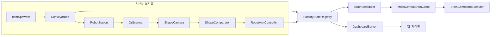

- 아카이브 일시: 2026-10-20 (KST) — 1단계 전체 구현보고서 원문 보관

# 스마트팩토리 시뮬레이션 구현 보고서 (1단계)

- 작성일: 2026-10-06
- 관련 문서: [프로젝트_개요.md](../프로젝트_개요.md), [기능_분류_요구사항.md](../기능_분류_요구사항.md), [에셋_다운로드_지침.md](../에셋_다운로드_지침.md)
- Unity 버전: `6000.0.35f1` (URP)
- 범위: 1단계 시뮬레이션 전체(다운로드·통합, 벨트/물품/QR/인식/분류, 교체 가능 중앙뇌 Mock, 웹 제어판)
- 로봇팔 이동 중 집기·들어 올리기: [SW_Unity_RobotPickPlace day 아카이브](../../../../소프트웨어/로봇집기분류/SW_Unity_RobotPickPlace_001/day/) (2026-10-07)

## 1. 다운로드 결과

| 항목 | Niryo One (Unity Robotics Hub) | Conveyor Belt System Simulation |
| --- | --- | --- |
| 다운로드 결과 | 성공 | 일부 완료(Assets 확보, Library 체크아웃 실패) |
| 저장소 URL | https://github.com/Unity-Technologies/Unity-Robotics-Hub.git | https://github.com/MuhammadNafishGinanjar/Conveyor-Belt-System-Simulation-in-Unity.git |
| 로컬 절대 경로 | `C:\Users\Slu93\Desktop\FactorySimulationDownloads\Unity-Robotics-Hub` | `C:\Users\Slu93\Desktop\FactorySimulationDownloads\Conveyor-Belt-System-Simulation-in-Unity` |
| 커밋 SHA | `b8d1e1d4c76c9ce75fc145cdbf55a9072cc77364` | `9595d3901d121b5dbc28a6e10113473c9384aac1` |
| 모델·Prefab 경로 | `tutorials/pick_and_place/PickAndPlaceProject/Assets/URDF/niryo_one/...` | `Assets/Prefabs`, `Assets/EKstudio`, `Assets/Scenes/Conveyor_Arduino.unity` |
| 메시 참조 확인 | `niryo_one.urdf` 존재, STL/프리팹 다수 확인 | Prefab·FBX·씬·스크립트(517 파일, Assets 기준) 확인 |
| 서브모듈·LFS | 서브모듈 3개 초기화 완료 | 해당 없음 |
| 누락·오류 | 없음 | 저장소에 포함된 `Library/` 때문에 Windows 경로 길이 오류로 전체 checkout 실패. **Assets만 사용** |
| Unity 실행 검증 | 미실행 | 미실행 |

## 2. 프로젝트 통합 내역

| 구분 | 경로 | 설명 |
| --- | --- | --- |
| Niryo URDF/메시 | `Assets/ThirdParty/NiryoOne/URDF` | Pick-and-Place 예제 URDF·STL·프리팹 |
| 컨베이어 Prefab/모델 | `Assets/ThirdParty/ConveyorBelt` | Prefabs, EKstudio, Materials |
| SmartFactory 코드 | `Assets/SmartFactory/Scripts` | Core/Conveyor/Items/Recognition/Robot/Brain/Dashboard |
| 셰이더 | `Assets/SmartFactory/Shaders/QrMaskBlit.shader` | QR 마스킹 Blit |
| 웹 제어판 | `Assets/StreamingAssets/Dashboard` | index.html, app.js, style.css, logo.svg |
| 씬 | `Assets/SmartFactory/Scenes/Factory.unity` | SampleScene 복제(오케스트레이터는 메뉴로 배치) |
| ZXing | `Assets/Plugins/ZXing/zxing.dll` | QR 생성·판독 |
| 패키지 | `Packages/manifest.json` | URDF Importer(Git), Newtonsoft JSON, AI Inference(추후 ONNX 연동용) |

컨베이어 원본 `Assets/Scripts`(Arduino/SerialPort)는 **복사하지 않음**. 벨트 제어는 `ConveyorBelt`로 새로 구현.

## 3. 아키텍처

## 4. 요구사항 대응표 (기능분류 요약)

| 분류 | 상태 | 구현 위치 |
| --- | --- | --- |
| 1.1~1.2 환경·실시간 동작 | 구현 | `FactoryOrchestrator`, `ConveyorBelt`, `RobotArmController` |
| 1.3 하드웨어 연동 | 미구현 | 문서 9장(향후) |
| 2.1~2.5 벨트·물품·QR·상태 | 구현 | `ConveyorBelt`, `ItemSpawner`, `QrLabelGenerator`, `FactoryStateRegistry` |
| 3.1~3.6 로봇 작업·상태 | 구현 | `RobotStation`, `RobotArmController`, `BatterySimulator` |
| 3.7~3.8 비교·에러 영역 | 구현 | `ShapeComparator`, `SortZoneMap`, `RobotStation` |
| 4.1~4.8 중앙뇌 | 일부 구현 | `ICentralBrainClient`, `MockCentralBrainClient`, `BrainScheduler`(Mock), `BrainCommandExecutor` |
| 5.1~5.8 제어판 | 구현 | `DashboardServer`, `StreamingAssets/Dashboard/*` |
| 9장 실제 HW | 미구현 | - |

## 5. 확정 처리 순서 구현

1. QR 스캔: `QrScanner` + ZXing  
2. 카메라 촬영: `ShapeCamera`  
3. QR 마스킹: `QrMaskBlit.shader`  
4. 모델 인식: `MockShapeClassifier`(기본), `OnnxShapeClassifier`(스텁, .onnx 연결 후 확장)  
5. 비교: `ShapeComparator`  
6. 불일치 → 에러 구역: `SortZoneMap.errorZone`  
7. 패널 불일치 개수: `FactoryStateRegistry.Sorting.mismatchCount` → SSE `/api/stream`

## 6. 임시 기본값

| 항목 | 값 | 변경 방법 |
| --- | --- | --- |
| 로봇팔 수 | 3 | `FactoryConfig.robotArmCount` 또는 `FactoryOrchestrator` 런타임 생성 |
| 벨트 속도 | 1.2 | `FactoryConfig.beltSpeed` |
| 생성 간격 | 1~5초 랜덤 | `FactoryConfig.spawnIntervalMin/Max` |
| 불일치 주입률 | 25% | `FactoryConfig.mismatchInjectionRate` |
| API 기본 주기 | 30분 | `FactoryConfig.defaultBrainIntervalMinutes`, 대시보드 select |
| 대시보드 포트 | 8080 | `FactoryConfig.dashboardPort` |
| 원 3D 형태 | 원기둥(Primitive Cylinder) | `ItemSpawner.ApplyVisual` |
| 일치 물품 구역 | 단일 NormalZone | `SortZoneMap.defaultNormalZone` |

## 7. 검증 결과

| 항목 | 결과 |
| --- | --- |
| C# 스크립트 작성·asmdef 구성 | 완료 |
| 에셋 robocopy 통합 | 완료 |
| Unity Editor Play Mode | **미실행** (본 환경에서 Unity 미기동) |
| 웹 대시보드 실제 브라우저 확인 | **미실행** |
| Teachable Machine ONNX 추론 | **미연동**(OnnxShapeClassifier 스텁) |
| Niryo URDF Importer 자동 Import | **미실행**(에셋 복사만, Editor Import 필요) |

## 8. 실행 방법

1. Unity에서 `Assets/SmartFactory/Scenes/Factory.unity` 열기  
2. 메뉴 **SmartFactory → Setup Factory Scene Orchestrator** 실행(씬에 `FactoryOrchestrator` 추가)  
3. Play  
4. 브라우저에서 `http://localhost:8080` 접속  
5. (선택) **SmartFactory → Save Masked Capture From Selected ShapeCamera** 로 학습용 PNG 저장  

## 9. 미구현·후속 과제

- 실제 LLM API 구현체(`HttpCentralBrainClient` 등)  
- Teachable Machine 학습 → ONNX Import → `OnnxShapeClassifier` Inference Engine 연동  
- Niryo One URDF Importer로 ArticulationBody 프리팹 생성 및 `RobotArmController` 연결  
- 컨베이어 ThirdParty Prefab을 씬에 배치(현재는 코드 생성 벨트)  
- 하드웨어 연동(문서 9장), QR/인식 실패 정책 확정, 일치 물품 다구역 규칙  
- Windows HttpListener 권한 이슈 시 URL ACL 또는 관리자 권한 확인  

## 10. 주요 클래스 목록

- `FactoryOrchestrator`, `FactoryStateRegistry`, `MainThreadDispatcher`  
- `ConveyorBelt`, `ItemSpawner`, `FactoryItem`, `QrLabelGenerator`, `UnprocessedZone`  
- `QrScanner`, `ShapeCamera`, `MockShapeClassifier`, `OnnxShapeClassifier`, `ShapeComparator`  
- `RobotArmController`, `RobotStation`, `SortZoneMap`, `BatterySimulator`  
- `ICentralBrainClient`, `MockCentralBrainClient`, `BrainScheduler`, `BrainCommandExecutor`  
- `DashboardServer`  

## 11. 공식 로봇팔 모델 (Robotic-Arm-Rig.fbx)

| 항목 | 경로·설명 |
| --- | --- |
| FBX 모델 | `Assets/RobotArm/Robotic-Arm-Rig.fbx` |
| 프리팹 (Editor 생성) | `Assets/RobotArm/Prefabs/RobotArm_Rig.prefab` |
| Resources (자동 로드) | `Assets/Resources/SmartFactory/RobotArm_Rig.prefab` |
| 바인딩 SO | `Assets/RobotArm/RoboticArmRigBinding.asset` |
| 코드 | `RobotArmRigBinding`, `RobotArmController.CreateFromPrefab` |

**1회 설정 (Unity Editor)**

1. 메뉴 **SmartFactory → Create Robot Arm Rig Prefab** 실행 (FBX + `RobotArmController` + 바인딩 자동 후보 생성)  
2. (필요 시) **SmartFactory → Robot Arm Rig Setup** 에서 `jointPaths` / `endEffectorPath` 수정 후 Save  
3. `FactoryConfig`의 `robotArmPrefab`에 `RobotArm_Rig` 연결 (비어 있으면 Play 시 `Resources/SmartFactory/RobotArm_Rig` 로드 시도)  
4. 프리팹 없으면 기존 **더미 4관절** (`CreateRuntimeArm`) 폴백  

IK는 바인딩된 FBX **본 Transform**에 적용됩니다. 집기 위치가 어긋나면 빈 자식 `GripPoint`를 만들어 `endEffectorPath`로 지정하세요.
