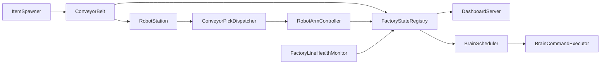

# 스마트팩토리 시뮬레이션 구현 현황 요약

- 문서 초기 생성 일시: 2026-10-06 (KST)
- 문서 수정 일시: 2026-10-20 (KST)
- 지시자: 이종인
- 작업자(문서): Composer — 레거시 구현보고서 요약·갱신

## 개요

1단계 시뮬레이션(벨트, 물품, 인식, 로봇 집기·Zone, Mock 중앙뇌, 웹 제어판) 구현 상태를 요약한다. 다운로드·통합 상세는 [day 아카이브](day/2026-10-06_000000_001_스마트팩토리_1단계_구현보고서_아카이브.md) 참조.

## 아키텍처

## 구현 상태(요약)

| 영역 | 상태 | 비고 |
| --- | --- | --- |
| 벨트·스폰·QR | 구현 | 에러 물류·연속 알림 포함 |
| 인식·판정 | 구현 | Mock 분류기 기본 |
| 로봇 집기·Zone | 구현 중 | 흡착·디스패처, Play 검증 일부 미확인 |
| 중앙뇌 | Mock | LLM API 미연동 |
| 대시보드 | 구현 | SSE, 로봇 reset API, 정체·에러 알림 |
| 라인 정체 감시 | 구현 | `FactoryLineHealthMonitor` |
| ONNX / 실 HW | 미구현 | |
| AI 물류센터(3구역·택배·혼잡·보고) | 구현 중 | `useThreeRegionLogistics`, `FactoryLogisticsCenter`, 대시보드 v2 |

## 주요 설정(`FactoryConfig`)

| 항목 | 기본값 |
| --- | --- |
| robotArmCount | 3 |
| beltLength | 12 (m) |
| beltSpeed | 1.2 |
| dashboardPort | 8080 |
| errorLogisticsSpawnRate | 0.005 |
| defaultConsecutiveErrorAlertThreshold | 5 |

## 실행

1. `Assets/SmartFactory/Scenes/Factory.unity` Play
2. 브라우저 `http://127.0.0.1:8080/`

## 검증 기록

| 항목 | 결과 |
| --- | --- |
| Unity Play (2026-10-06 보고) | 미실행 |
| 최신 Pick/Place | **미확인**(README 기준) |

## 수정 전후

| 항목 | 수정 전 | 수정 후 |
| --- | --- | --- |
| 보고서 경로 | `Info/구현 보고서/...` | 본 문서 + `day/` 아카이브 |

## 기능 ID

- 메인 **001**

## 상세 아카이브

- [2026-10-06 1단계 구현보고서](day/2026-10-06_000000_001_스마트팩토리_1단계_구현보고서_아카이브.md)
- 로봇 Pick/Place·Zone: [SW_Unity_RobotPickPlace_001/day/](../../../소프트웨어/로봇집기분류/SW_Unity_RobotPickPlace_001/day/)

## 기술 환경

- Unity `6000.0.35f1` — [기술_환경.md](../../../기술_환경.md)
